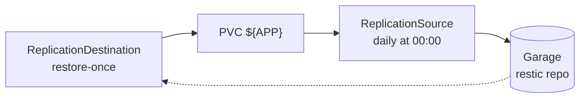

# Components

`k8s/components/` holds [Kustomize components](https://kubectl.docs.kubernetes.io/guides/config_management/components/): reusable sets of manifests that a namespace or an app pulls in, so the same alert, backup or scaler isn't copied into every app.

| Component | Added to | What it adds | Used by |
|---|---|---|---|
| `alerts/alertmanager` | Namespace | A Flux `Alert` and `Provider` that send Flux errors to Alertmanager | 18 namespaces |
| `flux/ghcr` | Namespace | The `gh-secret` pull secret for private images on ghcr.io | 3 namespaces |
| `flux/image-automation` | Namespace | An `ImageUpdateAutomation` that commits new image tags to `main` | 5 namespaces |
| `grafana/folder` | Namespace | A Grafana folder named after the namespace | 11 namespaces |
| `keda/dependencies` | App | A KEDA `ScaledObject` that scales the app to zero while a dependency is down | 20 apps |
| `middlewares/authentik` | App | An Envoy `SecurityPolicy` that puts the app's route behind Authentik | 2 apps |
| `storage/dragonfly/emulated` | App | A Dragonfly instance with snapshots to Garage | 4 apps |
| `volsync/local` | App | The app's PVC, restored from backup on creation, and a nightly backup to Garage | 14 apps |
| `volsync/remote` | App | A second nightly backup of the same PVC to Cloudflare R2 | 14 apps |

## Adding a component

A namespace component goes in the namespace's `kustomization.yaml`, and applies once to the whole namespace:

```yaml
apiVersion: kustomize.config.k8s.io/v1beta1
kind: Kustomization
namespace: media
resources:
  - ./namespace.yaml
  - ./immich/ks.yaml
components:
  - ../../components/alerts/alertmanager
  - ../../components/flux/ghcr
  - ../../components/flux/image-automation
```

An app component goes in the app's `ks.yaml`. The path is relative to the app's `app/` directory, hence the four `../`:

```yaml
spec:
  path: ./k8s/apps/default/mealie/app
  components:
    - ../../../../components/volsync/local
    - ../../../../components/volsync/remote
    - ../../../../components/keda/dependencies
```

## Variables

App components use variables such as `${APP}`. Flux fills them in from the app's `postBuild.substitute` after it builds the manifests:

```yaml
spec:
  postBuild:
    substitute:
      APP: *app
      DEPENDS_ON: "postgres"
      VOLSYNC_PGID: "100"
      VOLSYNC_PUID: "1002"
      VOLSYNC_CACHE_CAPACITY: 512Mi
```

A variable written as `${NAME:=default}` or `${NAME:-default}` falls back to the default when the app doesn't set it. Variables without a default, like `APP` and `DEPENDS_ON`, are required.

`APP` names the objects a component creates, and the components expect it to match the app's own objects: the Deployment for KEDA, the PVC for VolSync and the HTTPRoute for Authentik. When the chart names the Deployment differently from the app, set `APP` to the Deployment's name. Immich does this with `APP: immich-server`.

## Namespace components

### alerts/alertmanager

Adds a `Provider` that points at Alertmanager, and an `Alert` that forwards every error event from the namespace's Flux objects to it: Kustomizations, HelmReleases, sources and the image automation objects. The `exclusionList` drops errors that are usually transient, such as GitHub lookups and TCP timeouts:

```yaml
apiVersion: notification.toolkit.fluxcd.io/v1
kind: Alert
metadata:
  name: alertmanager
spec:
  providerRef:
    name: alertmanager
  eventSeverity: error
  eventSources:
    - kind: HelmRelease
      name: "*"
    - kind: Kustomization
      name: "*"
    # ... and the other Flux kinds
  exclusionList:
    - error.*lookup.*github
    - dial.*tcp.*timeout
    - waiting.*socket
```

The `Provider` posts the events to Alertmanager's API:

```yaml
apiVersion: notification.toolkit.fluxcd.io/v1
kind: Provider
metadata:
  name: alertmanager
spec:
  type: alertmanager
  address: http://alertmanager-operated.monitoring.svc.cluster.local:9093/api/v2/alerts/
```

### flux/ghcr

Adds an ExternalSecret that builds a `kubernetes.io/dockerconfigjson` secret named `gh-secret` from the `/github/ghcr` key in Akeyless. Pods use it as an image pull secret, and Flux `ImageRepository` objects use it to list tags of private images.

```yaml
apiVersion: external-secrets.io/v1
kind: ExternalSecret
metadata:
  name: &secret gh-secret
  namespace: flux-system
spec:
  refreshInterval: 5m
  secretStoreRef:
    kind: ClusterSecretStore
    name: akeyless-secret-store
  target:
    name: *secret
    creationPolicy: Owner
    deletionPolicy: "Delete"
    template:
      engineVersion: v2
      type: kubernetes.io/dockerconfigjson
      data:
        .dockerconfigjson: "{{ .dockersecret | toString }}"
  data:
    - secretKey: dockersecret
      remoteRef:
        key: /github/ghcr
```

The namespace's `kustomization.yaml` sets the namespace for everything it lists, which overrides the `flux-system` in this manifest. Each namespace that adds the component gets its own `gh-secret`.

An app's `ImageRepository` points at it with `secretRef`:

```yaml
apiVersion: image.toolkit.fluxcd.io/v1
kind: ImageRepository
metadata:
  name: personal-blog
spec:
  image: ghcr.io/jdavid77/personal-blog
  interval: 5m
  provider: generic
  secretRef:
    name: gh-secret
```

### flux/image-automation

Adds an `ImageUpdateAutomation` that runs every minute. When an `ImagePolicy` in the namespace picks a new tag, it rewrites the lines marked with a setter comment and pushes a commit to `main` as `fluxcdbot`:

```yaml
apiVersion: image.toolkit.fluxcd.io/v1
kind: ImageUpdateAutomation
metadata:
  name: image-automation
spec:
  interval: 1m0s
  sourceRef:
    kind: GitRepository
    name: home-cluster
    namespace: flux-system
  git:
    checkout:
      ref:
        branch: main
    commit:
      author:
        email: fluxcdbot@users.noreply.github.com
        name: fluxcdbot
      messageTemplate: |
        chore(images): automated image updates
        {{range .Changed.Changes}}
        - {{.OldValue}} -> {{.NewValue}}
        {{end}}
    push:
      branch: main
  update:
    strategy: Setters
```

The app provides an `ImagePolicy` that picks the tag. The personal blog takes the newest tag in its date format:

```yaml
apiVersion: image.toolkit.fluxcd.io/v1
kind: ImagePolicy
metadata:
  name: &repo personal-blog
spec:
  imageRepositoryRef:
    name: *repo
  filterTags:
    pattern: '^v\d{4}\.\d{2}\.\d{2}\.\d{2}$'
  policy:
    alphabetical:
      order: asc
```

The HelmRelease marks the tag with a setter comment that names the policy (`<namespace>:<policy>:tag`):

```yaml
image:
  repository: ghcr.io/jdavid77/personal-blog
  tag: v2026.08.31.01 # {"$imagepolicy": "default:personal-blog:tag"}
```

The app also provides the `ImageRepository`, shown under [flux/ghcr](#fluxghcr).

### grafana/folder

Adds a `GrafanaFolder` for the namespace's dashboards. The manifest has placeholder names, and a Kustomize `replacements` rule copies the namespace's name into the folder's name and title. The rule reads the `Namespace` object, so the namespace's `kustomization.yaml` must list `namespace.yaml`.

```yaml
apiVersion: grafana.integreatly.org/v1beta1
kind: GrafanaFolder
metadata:
  name: "namesace-placeholder"
spec:
  allowCrossNamespaceImport: true
  instanceSelector:
    matchLabels:
      grafana.internal/instance: grafana
  title: "namespace-placeholder"
```

The component's `kustomization.yaml` holds the rule:

```yaml
apiVersion: kustomize.config.k8s.io/v1alpha1
kind: Component
resources:
  - _folder.yaml
replacements:
  - source:
      kind: Namespace
      fieldPath: metadata.name
    targets:
      - select:
          kind: GrafanaFolder
        fieldPaths:
          - metadata.name
  - source:
      kind: Namespace
      fieldPath: metadata.name
    targets:
      - select:
          kind: GrafanaFolder
        fieldPaths:
          - spec.title
```

## App components

### keda/dependencies

Adds a KEDA `ScaledObject` that watches the blackbox exporter probes for the app's dependencies. While every probe succeeds, the app runs with its normal replica count. When any of them fails, KEDA scales the app to zero, so it doesn't crash-loop or write to a missing NFS share. It scales back up once the probes recover.

```yaml
apiVersion: keda.sh/v1alpha1
kind: ScaledObject
metadata:
  name: ${APP}
spec:
  cooldownPeriod: ${COOLDOWN_PERIOD:=300}
  idleReplicaCount: 0
  minReplicaCount: ${REPLICAS:=1}
  maxReplicaCount: ${REPLICAS:=1}
  advanced:
    restoreToOriginalReplicaCount: true
  scaleTargetRef:
    apiVersion: apps/v1
    kind: ${CONTROLLER:=Deployment}
    name: ${APP}
  triggers:
    - type: prometheus
      metadata:
        serverAddress: http://prometheus-operated.monitoring.svc.cluster.local:9090
        query: min(max_over_time(probe_success{job=~"probe/monitoring/(${DEPENDS_ON})"}[1m]))
        threshold: "1"
        activationThreshold: "0"
        ignoreNullValues: "0"
```

The query returns 1 only when every probe matched by `DEPENDS_ON` succeeded in the last minute. `ignoreNullValues: "0"` makes KEDA treat a missing metric as an error instead of a 0, so a Prometheus outage doesn't scale everything down.

| Variable | Default | Purpose |
|---|---|---|
| `APP` | required | Name of the workload to scale |
| `DEPENDS_ON` | required | Probe names joined with `\|`, for example `nfs\|immich` or `postgres` |
| `CONTROLLER` | `Deployment` | Workload kind, for example `StatefulSet` |
| `REPLICAS` | `1` | Replica count while dependencies are up |
| `COOLDOWN_PERIOD` | `300` | Seconds KEDA waits before scaling to zero |

### middlewares/authentik

Adds an Envoy Gateway `SecurityPolicy` that sends each request to the Authentik outpost (`ak-outpost-proxy` in `security`) before it reaches the app. Authentik sends users who aren't logged in to its login page, and Envoy passes Authentik's user headers (`X-authentik-username`, `X-authentik-email` and so on) to the app.

| Variable | Default | Purpose |
|---|---|---|
| `APP` | required | Names the policy, and is the default target |
| `EXT_AUTH_TARGET` | `${APP}` | Name of the route to protect |
| `EXT_AUTH_KIND` | `HTTPRoute` | Kind of the target |
| `EXT_AUTH_GROUP` | `gateway.networking.k8s.io` | API group of the target |

```yaml
apiVersion: gateway.envoyproxy.io/v1alpha1
kind: SecurityPolicy
metadata:
  name: ${APP}
spec:
  extAuth:
    failOpen: false
    headersToExtAuth:
      - X-Forwarded-Proto
      - X-Forwarded-For
      - cookie
    http:
      backendRefs:
        - name: ak-outpost-proxy
          namespace: security
          port: 9000
      path: /outpost.goauthentik.io/auth/envoy
      headersToBackend:
        - Set-Cookie
        - Location
        - X-authentik-username
        - X-authentik-groups
        - X-authentik-email
        - X-authentik-name
        - X-authentik-uid
        - authorization
  targetRefs:
    - group: ${EXT_AUTH_GROUP:-gateway.networking.k8s.io}
      kind: ${EXT_AUTH_KIND:-HTTPRoute}
      name: ${EXT_AUTH_TARGET:-${APP}}
```

`failOpen: false` blocks requests while the outpost is unreachable instead of letting them through.

n8n protects only its form route:

```yaml
spec:
  components:
    - ../../../../components/middlewares/authentik
  postBuild:
    substitute:
      APP: *app
      EXT_AUTH_TARGET: n8n-form
```

### storage/dragonfly/emulated

Adds a [Dragonfly](https://www.dragonflydb.io/) instance named `dragonfly-${APP}`, a Redis-compatible store, for apps that need one. It runs in emulated cluster mode, with a 512 MiB memory limit, and snapshots to the `dragonfly-snapshots` bucket in Garage every 12 hours. An ExternalSecret provides the Garage credentials.

| Variable | Default | Purpose |
|---|---|---|
| `APP` | required | Names the instance and its snapshot folder |
| `DRAGONFLY_REPLICAS` | `1` | Number of Dragonfly pods |

A trimmed version of the instance:

```yaml
apiVersion: dragonflydb.io/v1alpha1
kind: Dragonfly
metadata:
  name: dragonfly-${APP}
spec:
  image: ghcr.io/dragonflydb/dragonfly:v2.1.0
  replicas: ${DRAGONFLY_REPLICAS:=1}
  resources:
    requests:
      cpu: 100m
      memory: 128Mi
    limits:
      memory: 512Mi
  env:
    - name: MAX_MEMORY
      valueFrom:
        resourceFieldRef:
          resource: limits.memory
          divisor: 1Mi
  args:
    - "--maxmemory=$(MAX_MEMORY)Mi"
    - "--cluster_mode=emulated"
    - "--s3_endpoint=garage.storage.svc.cluster.local:3900"
    - "--s3_use_https=false"
  snapshot:
    cron: "0 */12 * * *"
    dir: s3://dragonfly-snapshots/${APP}
```

`MAX_MEMORY` reads the container's memory limit, so Dragonfly's `--maxmemory` always matches it.

The app connects to the instance's Service. Paperless sets:

```yaml
PAPERLESS_REDIS: redis://dragonfly-paperless.documents.svc.cluster.local:6379
```

### volsync/local

Creates the app's PVC and backs it up every night at midnight to a restic repository in Garage.



It adds four objects:

- An ExternalSecret, `${APP}-restic`, with the restic password and Garage keys. The repository is `s3:http://garage.storage.svc.cluster.local:3900/${APP}`.
- A `ReplicationSource` that snapshots the PVC through Longhorn and backs the snapshot up with restic, keeping 7 daily backups.
- A `ReplicationDestination` with a `restore-once` manual trigger, which restores the latest backup.
- The PVC itself, with the ReplicationDestination as its `dataSourceRef`.

The ExternalSecret builds the restic settings from two Akeyless secrets:

```yaml
apiVersion: external-secrets.io/v1
kind: ExternalSecret
metadata:
  name: "${APP}-restic"
spec:
  secretStoreRef:
    kind: ClusterSecretStore
    name: akeyless-secret-store
  target:
    name: "${APP}-restic"
    template:
      engineVersion: v2
      data:
        RESTIC_REPOSITORY: s3:http://garage.storage.svc.cluster.local:3900/${APP}
        RESTIC_PASSWORD: "{{ .RESTIC_PASSWORD }}"
        AWS_ACCESS_KEY_ID: "{{ .GARAGE_KEY_ID }}"
        AWS_SECRET_ACCESS_KEY: "{{ .GARAGE_KEY_SECRET }}"
  dataFrom:
    - extract:
        key: /volsync/restic
    - extract:
        key: /garage/key
```

The `ReplicationSource` runs the nightly backup:

```yaml
apiVersion: volsync.backube/v1alpha1
kind: ReplicationSource
metadata:
  name: ${APP}
spec:
  sourcePVC: ${APP}
  trigger:
    schedule: "0 0 * * *"
  restic:
    copyMethod: Snapshot
    pruneIntervalDays: 7
    repository: "${APP}-restic"
    volumeSnapshotClassName: longhorn-snapshot-vsc
    cacheCapacity: "${VOLSYNC_CACHE_CAPACITY:-2Gi}"
    cacheStorageClassName: "longhorn-cache"
    storageClassName: "longhorn-snapshot"
    moverSecurityContext:
      runAsUser: ${VOLSYNC_PUID:-1000}
      runAsGroup: ${VOLSYNC_PGID:-1000}
      fsGroup: ${VOLSYNC_PGID:-1000}
    retain:
      daily: 7
```

`copyMethod: Snapshot` backs up a Longhorn snapshot of the PVC instead of the live volume, so the app keeps running during the backup.

The `ReplicationDestination` and the PVC handle the restore:

```yaml
apiVersion: volsync.backube/v1alpha1
kind: ReplicationDestination
metadata:
  name: ${APP}
spec:
  trigger:
    manual: restore-once
  restic:
    repository: "${APP}-restic"
    copyMethod: Snapshot
    volumeSnapshotClassName: longhorn-snapshot-vsc
    storageClassName: "longhorn-snapshot"
    capacity: "${VOLSYNC_CACHE_CAPACITY:-2Gi}"
    moverSecurityContext:
      runAsUser: ${VOLSYNC_PUID:-1000}
      runAsGroup: ${VOLSYNC_PGID:-1000}
      fsGroup: ${VOLSYNC_PGID:-1000}
---
apiVersion: v1
kind: PersistentVolumeClaim
metadata:
  name: ${APP}
spec:
  accessModes: ["ReadWriteOnce"]
  dataSourceRef:
    kind: ReplicationDestination
    apiGroup: volsync.backube
    name: "${APP}"
  resources:
    requests:
      storage: "${VOLSYNC_CACHE_CAPACITY:-2Gi}"
  storageClassName: "longhorn"
```

Because the PVC uses the ReplicationDestination as its data source, a new PVC starts with the latest backup. Deleting the app and letting Flux recreate it restores its data. The app mounts the PVC by name:

```yaml
persistence:
  config:
    existingClaim: mealie
```

| Variable | Default | Purpose |
|---|---|---|
| `APP` | required | Name of the PVC, the VolSync objects and the restic repository |
| `VOLSYNC_CACHE_CAPACITY` | `2Gi` | Size of the restic cache, and also the size of the PVC |
| `VOLSYNC_PUID` | `1000` | User the backup mover runs as |
| `VOLSYNC_PGID` | `1000` | Group the backup mover runs as |

Set the user and group to the ones the app runs as, otherwise the mover can't read the files.

### volsync/remote

Adds a second `ReplicationSource`, `${APP}-remote`, that backs up the same PVC at 02:00 to a restic repository in Cloudflare R2 (`jnobrega-${APP}`), also keeping 7 daily backups. It uses the same variables as `volsync/local`. It doesn't create the PVC, so apps always add both.

```yaml
apiVersion: volsync.backube/v1alpha1
kind: ReplicationSource
metadata:
  name: ${APP}-remote
spec:
  sourcePVC: ${APP}
  trigger:
    schedule: "0 2 * * *"
  restic:
    copyMethod: Snapshot
    pruneIntervalDays: 7
    repository: "${APP}-restic-remote"
    volumeSnapshotClassName: longhorn-snapshot-vsc
    cacheCapacity: "${VOLSYNC_CACHE_CAPACITY:-2Gi}"
    cacheStorageClassName: "longhorn-cache"
    storageClassName: "longhorn-snapshot"
    moverSecurityContext:
      runAsUser: ${VOLSYNC_PUID:-1000}
      runAsGroup: ${VOLSYNC_PGID:-1000}
      fsGroup: ${VOLSYNC_PGID:-1000}
    retain:
      daily: 7
```

Its ExternalSecret, `${APP}-restic-remote`, uses the same restic password from `/volsync/restic` with the R2 keys from `/r2/key`.
