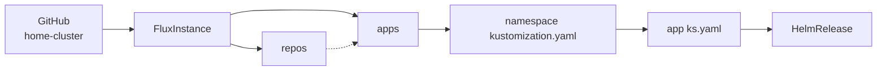

# GitOps

[Flux](https://fluxcd.io/) keeps the cluster in sync with the `main` branch. Anything under `k8s/` that merges to `main` ends up in the cluster, and Flux prunes anything removed from the repository.

## How Flux starts

The [Flux Operator](https://fluxcd.control-plane.io/operator/) installs Flux through a `FluxInstance` (`k8s/apps/flux-system/flux-operator/instance/`). The instance runs Flux 2.10 with the image reflector and image automation controllers, and syncs the `home-cluster` GitRepository from `./k8s/flux` using a GitHub App for authentication.

[`k8s/flux/cluster.yaml`](https://github.com/Jdavid77/home-cluster/blob/main/k8s/flux/cluster.yaml) defines the two root Kustomizations:

| Kustomization | Path | Purpose |
|---|---|---|
| `repos` | `k8s/flux/repos` | The OCIRepository sources for every Helm chart |
| `apps` | `k8s/apps` | Every app in the cluster. Depends on `repos`, so the chart sources exist first |



## Defaults for every app

The [`apps` Kustomization](https://github.com/Jdavid77/home-cluster/blob/main/k8s/flux/cluster.yaml#L16-L72) patches every child Kustomization it creates. Each one gets SOPS decryption and `deletionPolicy: WaitForTermination`, plus a patch for every HelmRelease inside it:

| Setting | Value |
|---|---|
| CRDs on install and upgrade | `CreateReplace` |
| Install strategy | `RetryOnFailure`, 3 retries |
| Upgrade remediation | Roll back after 3 failed retries |
| Rollback and failed upgrades | Clean up and recreate resources |
| Uninstall | Drop the Helm history |

Apps don't repeat these settings in their own HelmReleases.

## Chart sources

Every chart comes from an `OCIRepository` in `k8s/flux/repos/oci/`, one file per chart, all in the `flux-system` namespace. A HelmRelease points at its source with `chartRef`:

```yaml
spec:
  chartRef:
    kind: OCIRepository
    name: cilium
    namespace: flux-system
```

Keeping the version (`spec.ref.tag`) in the OCIRepository means Renovate bumps one file per chart, and several HelmReleases can share a chart.

## App layout

Each namespace has a directory under `k8s/apps/`. Its `kustomization.yaml` creates the namespace and lists one `ks.yaml` per app. The examples below use the `media` namespace and immich:

```text
k8s/apps/media/
├── kustomization.yaml   # namespace, the apps' ks.yaml files, namespace-wide components
├── namespace.yaml
└── immich/
    ├── ks.yaml          # the Flux Kustomization for the app
    └── app/
        ├── kustomization.yaml
        ├── helm-release.yaml
        ├── configmap.yaml
        └── secret.yaml  # an ExternalSecret
```

### Namespace kustomization.yaml

The namespace's `kustomization.yaml` sets the namespace for everything it lists, creates the `Namespace` itself and adds the components shared by the whole namespace:

```yaml
apiVersion: kustomize.config.k8s.io/v1beta1
kind: Kustomization
namespace: media
resources:
  - ./namespace.yaml
  - ./qbittorrent/ks.yaml
  - ./audiobookshelf/ks.yaml
  - ./metube/ks.yaml
  - ./immich/ks.yaml
  - ./booklore/ks.yaml
  - ./shelfmark/ks.yaml
components:
  - ../../components/alerts/alertmanager
  - ../../components/flux/ghcr
  - ../../components/flux/image-automation
```

To add an app, add its `ks.yaml` to `resources`. Apps that aren't listed here never reach the cluster.

`namespace.yaml` also sets the Pod Security level for the namespace:

```yaml
apiVersion: v1
kind: Namespace
metadata:
  name: media
  labels:
    pod-security.kubernetes.io/enforce: privileged
    pod-security.kubernetes.io/enforce-version: latest
```

### ks.yaml

`ks.yaml` is the Flux Kustomization for one app. Flux creates it in the app's namespace and builds the manifests in `app/` from it:

```yaml
apiVersion: kustomize.toolkit.fluxcd.io/v1
kind: Kustomization
metadata:
  name: &app immich
spec:
  targetNamespace: media
  dependsOn:
    - name: external-secrets-store
      namespace: external-secrets
    - name: envoy
      namespace: network
  path: ./k8s/apps/media/immich/app
  prune: true
  sourceRef:
    kind: GitRepository
    name: home-cluster
    namespace: flux-system
  healthChecks:
    - apiVersion: helm.toolkit.fluxcd.io/v2
      kind: HelmRelease
      name: immich
      namespace: media
  healthCheckExprs:
    - apiVersion: external-secrets.io/v1
      kind: ExternalSecret
      failed: status.conditions.filter(e, e.type == 'Ready').all(e, e.reason == 'SecretSyncedError')
      current: status.conditions.filter(e, e.type == 'Ready').all(e, e.reason == 'SecretSynced')
  components:
    - ../../../../components/keda/dependencies
  postBuild:
    substitute:
      APP: immich-server
      DEPENDS_ON: "nfs|immich"
  wait: true
  interval: 30m
  retryInterval: 2m
  timeout: 15m
```

| Field | What it does |
|---|---|
| `targetNamespace` | Puts every object built from `app/` in this namespace, so the files in `app/` don't set one |
| `dependsOn` | Other Flux Kustomizations that must be ready first. Most apps wait for the Akeyless secret store, and apps with a route wait for Envoy |
| `path` | The directory Flux builds, always the app's own `app/` |
| `prune` | Deletes objects from the cluster when they are removed from the repository |
| `healthChecks` | Objects that must be ready before Flux marks the app ready. Usually the app's HelmRelease |
| `healthCheckExprs` | Tells Flux how to read an ExternalSecret's status: ready on `SecretSynced`, failed on `SecretSyncedError`. Flux can't read that status on its own |
| `components` | [Components](components.md) added to this app only. Paths are relative to `app/` |
| `postBuild.substitute` | Variables that Flux replaces in the built manifests, used by the [components](components.md#variables) |
| `wait` | Waits for every object to be ready, not only those in `healthChecks` |
| `interval`, `retryInterval`, `timeout` | Reconcile every 30 minutes, retry after 2 minutes on failure and give up on a single attempt after 15 minutes |

Flux adds the `apps` defaults (SOPS decryption, `WaitForTermination` and the HelmRelease settings) on top of this file.

### app/kustomization.yaml

A plain Kustomize file that lists the manifests in `app/`:

```yaml
apiVersion: kustomize.config.k8s.io/v1beta1
kind: Kustomization
resources:
  - helm-release.yaml
  - secret.yaml
  - configmap.yaml
```

### app/helm-release.yaml

Most apps use the [bjw-s app-template](https://bjw-s-labs.github.io/helm-charts/docs/app-template/) chart, which deploys any container image from values alone. A trimmed version of the immich HelmRelease:

```yaml
apiVersion: helm.toolkit.fluxcd.io/v2
kind: HelmRelease
metadata:
  name: &app immich
spec:
  interval: 15m
  timeout: 5m
  chartRef:
    kind: OCIRepository
    name: app-template
    namespace: flux-system
  maxHistory: 2
  values:
    controllers:
      server:
        strategy: RollingUpdate
        annotations:
          secret.reloader.stakater.com/reload: immich-secret
          configmap.reloader.stakater.com/reload: immich-configmap
        initContainers:
          init-db:
            image:
              repository: ghcr.io/home-operations/postgres-init
              tag: 18.7@sha256:6d4cfa4b...
            envFrom:
              - secretRef:
                  name: immich-secret
        containers:
          main:
            image:
              repository: ghcr.io/immich-app/immich-server
              tag: v3.4.1@sha256:7c489add...
            envFrom:
              - secretRef:
                  name: immich-secret
              - configMapRef:
                  name: immich-configmap
        pod:
          securityContext:
            runAsUser: 1002
            runAsGroup: 100
            runAsNonRoot: true
            fsGroup: 100
    service:
      server:
        controller: server
        ports:
          http:
            port: &port 2283
    route:
      frontend:
        parentRefs:
          - kind: Gateway
            name: internal
            namespace: network
            sectionName: websecure
        hostnames:
          - photos.jnobrega.com
        rules:
          - backendRefs:
              - name: immich-server
                port: *port
    persistence:
      library:
        type: nfs
        server: 192.168.1.84
        path: /photos
        globalMounts:
          - path: /usr/src/app/upload
```

- `chartRef` points at the shared `app-template` OCIRepository in `flux-system`, so the chart version lives in one place.
- Image tags carry a digest (`tag@sha256:...`). Renovate updates both, and the digest pins the exact image even if a tag is pushed again.
- The Reloader annotations restart the pods when the Secret or ConfigMap changes.
- The `init-db` init container creates the Postgres database and user before the app starts, using the `INIT_POSTGRES_*` variables from the secret.
- `route` creates an HTTPRoute on the `internal` gateway. An app that should be public uses the `external` gateway instead.
- The release has no install or upgrade settings because the `apps` defaults add them.

## Updates

[Renovate](https://docs.renovatebot.com/) watches the repository and opens PRs for chart versions, container images, GitHub Actions and the Talos versions in `talos/topf.yaml`. It builds on the [home-operations presets](https://github.com/home-operations/renovate-presets), and `.renovate/` adds the repository's own rules:

| File | Purpose |
|---|---|
| `autoMerge.json` | Which updates merge without review |
| `groups.json` | Packages updated together in one PR, such as the Flux Operator chart and its instance |
| `labels.json` | PR labels by update type and datasource |

## Validation

The `Validate` workflow runs `flux schema validate` over `k8s/` on every PR that touches it, on every push to `main` and every 12 hours. It runs on the self-hosted `home-ops-runner`, and `.fluxschema.yaml` configures where the CRD schemas come from.
