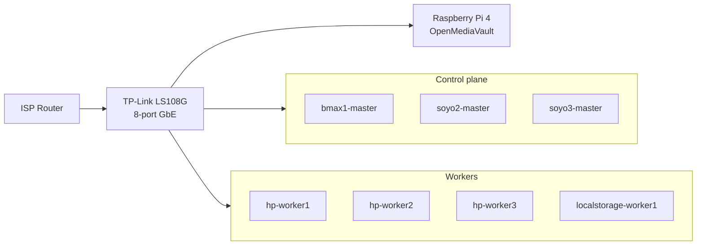

# Overview

This repository holds the configuration for my home Kubernetes cluster: a 7-node bare-metal cluster running [Talos Linux](https://www.talos.dev/) and managed through GitOps.

- **[topf](https://github.com/postfinance/topf)** generates and applies the Talos machine configs.
- **[Flux](https://fluxcd.io/)** reconciles the cluster state from this repository.
- **[Renovate](https://docs.renovatebot.com/)** opens pull requests for dependency updates.
- **[Terraform](https://www.terraform.io/)** manages the services outside the cluster (Akeyless, Authentik, Garage), planned and applied through Atlantis.

## Repository layout

| Directory | Purpose |
|---|---|
| `k8s/` | Everything Flux reconciles: apps, shared Kustomize components and the Flux entrypoint |
| `talos/` | Node configuration (`topf.yaml` plus patches for all nodes, control plane, workers and single nodes) |
| `terraform/` | External services, one workspace per service |
| `bootstrap/` | One-time cluster bootstrap (CRDs, Flux Operator and encrypted bootstrap secrets) |

## Topology

The nodes share one gigabit switch, with a Raspberry Pi 4 as the NAS. The network is flat for now.

## Hardware

| Node | Role | Model | Disk | RAM |
|---|---|---|---|---|
| bmax1-master | Control plane | Bmax B1 Pro (N4000) | 128 GB SSD | 8 GB |
| soyo2-master | Control plane | SOYO M2 Plus v1 | 512 GB SSD | 16 GB |
| soyo3-master | Control plane | SOYO M2 Plus v1 | 512 GB SSD | 16 GB |
| hp-worker1 | Worker | HP EliteDesk 800 G3 | 240 GB SSD | 20 GB |
| hp-worker2 | Worker | HP Compaq 8300 SFF | 1 TB HDD + 240 GB SSD | 28 GB |
| hp-worker3 | Worker | HP Compaq 8300 SFF | 500 GB HDD + 240 GB SSD | 32 GB |
| localstorage-worker1 | Worker | SOYO N95 | 512 GB SSD | 16 GB |
| NAS | OpenMediaVault | Raspberry Pi 4 | 3 TB (2 + 1) | 8 GB |

## Core components

| Area | Components |
|---|---|
| Networking | Cilium, Envoy Gateway, cloudflared, external-dns, Tailscale Operator, cert-manager, Spegel |
| Storage | Longhorn, OpenEBS, Garage, Zot, Dragonfly, VolSync |
| Security | External Secrets (Akeyless), Authentik, Kyverno, Trivy Operator |
| Observability | kube-prometheus-stack, Grafana, VictoriaLogs, OpenTelemetry, Gatus |
| Automation | Flux, KEDA, Tuppr, Renovate |
